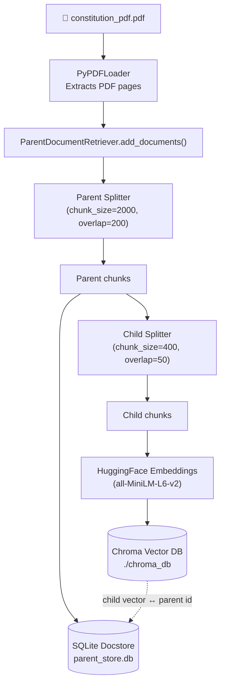
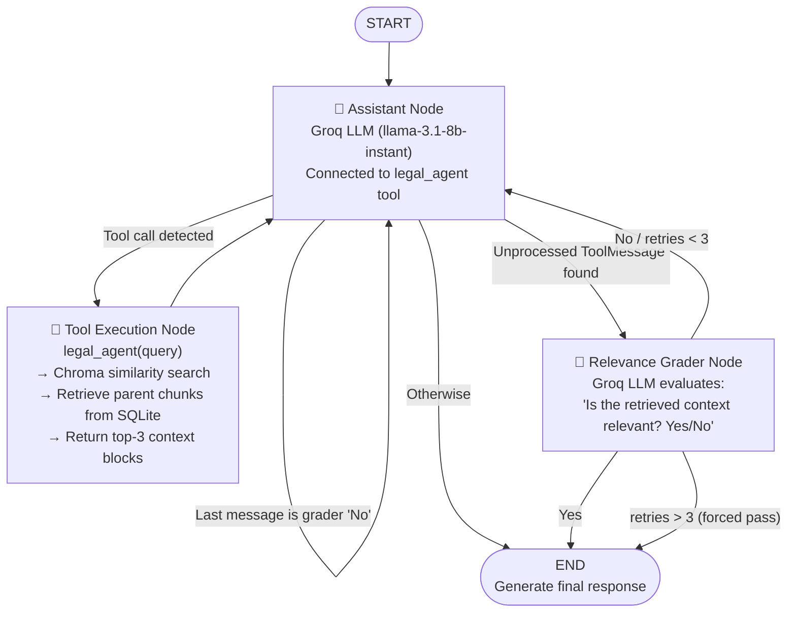
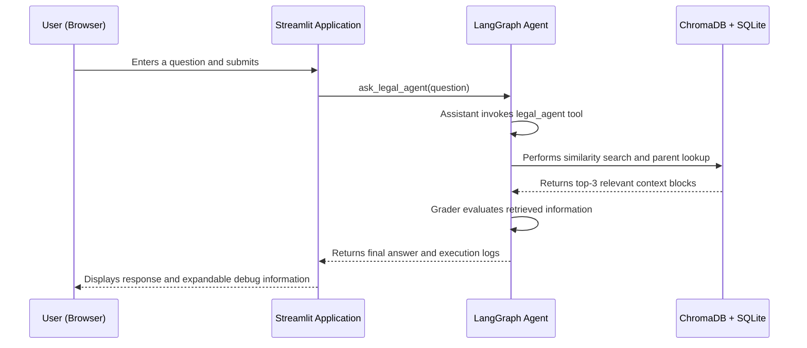

# 📜 Legal RAG Agent — Constitution of India Q&A

A Retrieval-Augmented Generation (RAG) application developed using **LangGraph, LangChain, ChromaDB, and Groq (Llama 3.1)** to answer questions related to the Constitution of India.

The project combines **Parent-Child document retrieval**, an **LLM-based relevance evaluation loop**, and an interactive **Streamlit interface** to provide accurate, context-aware answers.

---

## ✨ Key Features

- **Parent-Child Chunking:** Divides documents into smaller child chunks (400 characters) for accurate semantic retrieval and larger parent chunks (2000 characters) to preserve surrounding context.
- **Persistent Data Storage:** Stores child chunk embeddings in a local ChromaDB vector database and parent documents in an SQLite database.
- **LLM-Based Tool Calling:** Uses Groq's `llama-3.1-8b-instant` model to determine when the `legal_agent` retrieval tool should be invoked through LangGraph's `ToolNode`.
- **Self-Evaluation Mechanism:** An additional LLM-based grader evaluates the relevance of retrieved information. If the context is insufficient, the agent repeats the retrieval process, allowing a maximum of 3 retries.
- **Interactive Streamlit Interface:** Provides a chat-based interface with an expandable section for viewing execution details and agent state logs.

---

## 🗂️ Project Structure

```text
.
├── constitution_pdf.pdf      # Input document containing the Constitution of India
├── chunking.py               # Embedding configuration, ChromaDB, SQLite docstore and retriever
├── load_pdf.py               # Extracts, splits and indexes the PDF document
├── custom_tools.py           # Defines the legal_agent retrieval tool
├── prompt.py                 # System instructions and agent behavior
├── state.py                  # LangGraph state definition
├── grader.py                 # Evaluates the relevance of retrieved context
├── rag_agent.py              # Constructs and executes the LangGraph workflow
├── user_input.py             # Streamlit-based user interface
├── requirements.txt          # Required Python packages
└── .env                      # Stores the GROQ_API_KEY
```

---

## 🧠 System Architecture and Workflow

### 1. Document Indexing Process (`load_pdf.py`)

This process runs initially to extract the contents of the Constitution PDF and prepare them for retrieval.



**Process explanation:**

1. `PyPDFLoader` reads and extracts text from the Constitution PDF.
2. `ParentDocumentRetriever` divides the extracted content into larger parent chunks.
3. Each parent chunk is further separated into smaller child chunks.
4. HuggingFace's `all-MiniLM-L6-v2` model generates embeddings for the child chunks.
5. The embeddings are indexed and saved in ChromaDB.
6. The corresponding parent documents are stored in SQLite for later retrieval.

### 2. Question Answering and Agent Workflow (`rag_agent.py`)

Whenever a user submits a question, the LangGraph agent executes the following workflow.



**Workflow explanation:**

1. The assistant receives the user's question.
2. The Groq LLM determines whether the retrieval tool needs to be called.
3. If required, the `legal_agent` tool searches ChromaDB for relevant child chunks.
4. The corresponding parent documents are fetched from SQLite.
5. The top 3 parent chunks are returned as contextual information.
6. The grader checks whether the retrieved information is relevant to the original question.
7. If the context is relevant, the workflow proceeds to completion.
8. If the context is not relevant, the agent attempts retrieval again, subject to the maximum retry limit.
9. Finally, the assistant generates its response using the retrieved information.

### 3. Streamlit User Interaction (`user_input.py`)

The Streamlit application acts as the interface between the user and the LangGraph agent.



---

## ⚙️ Installation and Execution

### 1. Install the required packages

Run the following command from the project directory:

```bash
pip install -r requirements.txt
```

> **Note:** `sqlite3` comes bundled with Python's standard library. If installation fails because of this package, remove it from `requirements.txt`.

### 2. Set up the API key

Create a `.env` file in the root directory and add your Groq API key:

```env
GROQ_API_KEY=your_groq_api_key_here
```

### 3. Generate the document index

Execute the following script to process the PDF and create the required databases:

```bash
python load_pdf.py
```

This generates the following resources:

- `./chroma_db/` — Contains vector embeddings of the child chunks.
- `./parent_store.db` — Stores the original parent chunk contents.

**Note:** Run this script initially and whenever the source PDF is modified.

### 4. Launch the Streamlit application

Start the application using:

```bash
streamlit run user_input.py
```

### 5. Use the agent directly through Python

The agent can also be accessed without launching the Streamlit interface.

```python
from rag_agent import ask_legal_agent

answer, logs = ask_legal_agent("Is my right to equality protected by the constitution?")
print(answer)
```

---

## 🧩 Description of Core Components

| File | Purpose |
|---|---|
| `chunking.py` | Implements the custom `SQLiteDocStore` using SQLite and configures embeddings, ChromaDB, text splitters, and the `ParentDocumentRetriever`. |
| `load_pdf.py` | Reads the Constitution PDF, creates parent and child chunks, and stores them in the vector database and document store. |
| `custom_tools.py` | Defines the `legal_agent` LangChain tool, which performs retrieval and returns the top 3 parent chunks along with their page information. |
| `prompt.py` | Contains the system prompt that establishes the agent's role as a constitutional information assistant and restricts responses to retrieved context. |
| `state.py` | Defines the LangGraph state using a `TypedDict`, containing the conversation messages and grader retry counter. |
| `grader.py` | Implements the relevance-checking node using Groq. It evaluates retrieved content with a Yes/No response and enforces the maximum retry limit. |
| `rag_agent.py` | Creates and compiles the LangGraph workflow, manages execution routing, maintains debug logs through `get_state_logs()`, and exposes `ask_legal_agent()` for querying. |
| `user_input.py` | Implements the Streamlit chat interface, handles user questions, displays generated answers, and provides access to execution logs. |

---

## 🔐 Security Considerations

- Never upload the `.env` file or expose API credentials in a public GitHub repository. Ensure `.env` is included in `.gitignore`.
- If a Groq API key has previously been pushed to a public repository, revoke it immediately through the Groq console and generate a replacement.
- The `chroma_db/` directory and `parent_store.db` database may contain extracted document contents. Protect these files appropriately, particularly when working with confidential documents.

---

## 🚀 Future Enhancements

- **Streaming Output:** Introduce real-time response streaming in the Streamlit chat interface.
- **Embedding Optimization:** Implement embedding caching to prevent unnecessary reprocessing of unchanged PDF documents.
- **Source Citations:** Include relevant Constitution article numbers and PDF page references in generated answers.
- **Automated Testing:** Develop unit tests for `SQLiteDocStore` functionality and LangGraph routing behavior.
- **Confidence Handling:** Replace the current forced-pass mechanism after the maximum grader retries with a user-visible low-confidence warning when relevant context cannot be retrieved.

---

**Tech Stack:** Python | LangChain | LangGraph | ChromaDB | SQLite | HuggingFace Embeddings | Groq LLM | Streamlit
