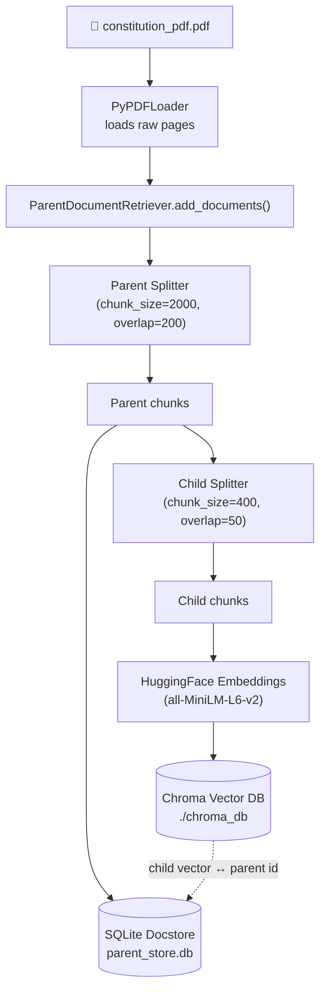
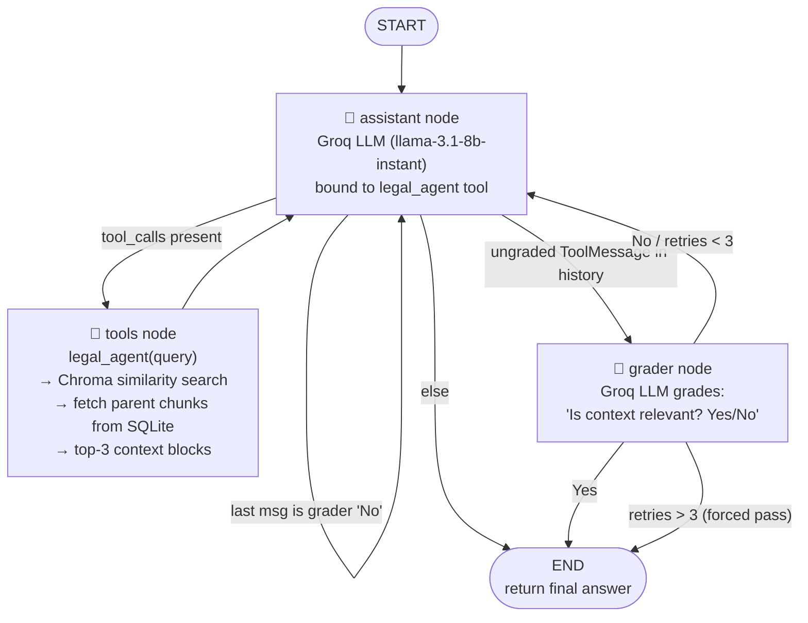
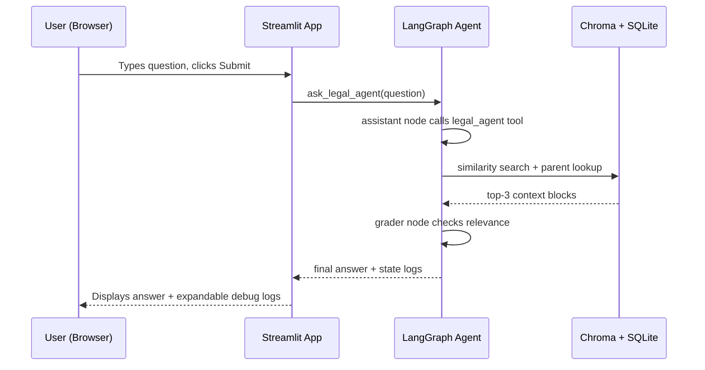

# 📜 Legal RAG Agent — Constitution of India Q&A


# You tube link:   https://youtu.be/DN29xHfOXo4

A Retrieval-Augmented Generation (RAG) agent built with **LangGraph**, **LangChain**, **Chroma**, and **Groq (Llama 3.1)** that answers questions about the Constitution of India using a **Parent-Child retrieval** strategy, a **self-grading loop**, and a **Streamlit** front end.

---

## ✨ Features

- **Parent-Child chunking** — small "child" chunks (400 chars) are embedded for precise semantic search, while larger "parent" chunks (2000 chars) are returned for full context.
- **Persistent storage** — child vectors live in a local **Chroma** DB; parent chunks live in a local **SQLite** docstore.
- **Agentic tool use** — the LLM (Groq `llama-3.1-8b-instant`) decides when to call the `legal_agent` retrieval tool via LangGraph's `ToolNode`.
- **Self-correcting grader** — a second LLM call grades whether retrieved context is actually relevant; if not, the agent loops back and tries again (up to 3 retries).
- **Streamlit UI** — simple chat-style interface with an expandable debug/state log panel.

---

## 🗂️ Project Structure

```
.
├── constitution_pdf.pdf     # Source document (Constitution of India)
├── chunking.py              # Embeddings, Chroma vectorstore, SQLite docstore, ParentDocumentRetriever
├── load_pdf.py               # One-time script: loads PDF -> splits -> indexes into vectorstore/docstore
├── custom_tools.py          # `legal_agent` tool exposed to the LLM (wraps the retriever)
├── prompt.py                 # System prompt defining the assistant's persona & rules
├── state.py                  # LangGraph State schema (messages, grader_retries)
├── grader.py                  # Relevance-grading node (Yes/No) using Groq LLM
├── rag_agent.py               # Builds & compiles the LangGraph graph; main entry point
├── user_input.py             # Streamlit app (chat UI)
├── requirements.txt
└── .env                       # GROQ_API_KEY (⚠️ see Security Notes below)
```

---

## 🧠 How It Works (Flowchart)

### 1. Indexing pipeline (`load_pdf.py`, run once)



### 2. Query / Agent pipeline (`rag_agent.py`, run on every question)



### 3. Streamlit interaction (`user_input.py`)



---

## ⚙️ Setup

### 1. Install dependencies
```bash
pip install -r requirements.txt
```
> Note: `sqlite3` is part of Python's standard library — remove it from `requirements.txt` if `pip install` fails on it.

### 2. Configure environment variables
Create a `.env` file in the project root:
```
GROQ_API_KEY=your_groq_api_key_here
```

### 3. Build the vector index (run once, or whenever the PDF changes)
```bash
python load_pdf.py
```
This creates:
- `./chroma_db/` — Chroma vector store (child chunk embeddings)
- `./parent_store.db` — SQLite store (parent chunk text)

### 4. Run the Streamlit app
```bash
streamlit run user_input.py
```

### 5. Or query programmatically
```python
from rag_agent import ask_legal_agent

answer, logs = ask_legal_agent("Is my right to equality protected by the constitution?")
print(answer)
```

---

## 🧩 Key Components Explained

| File | Responsibility |
|---|---|
| `chunking.py` | Defines `SQLiteDocStore` (custom `BaseStore` backed by SQLite), the Chroma vectorstore, embedding model, text splitters, and the `ParentDocumentRetriever` that ties them together. |
| `load_pdf.py` | Loads the PDF and populates the vectorstore + docstore. Run this before asking any questions. |
| `custom_tools.py` | Exposes `legal_agent` as a LangChain `@tool`, so the LLM can call it during the graph's `assistant` step. It formats the top 3 retrieved parent chunks with page numbers. |
| `prompt.py` | System prompt instructing the model to act as a constitutional interpreter and only answer from retrieved context. |
| `state.py` | TypedDict defining the LangGraph state: a running `messages` list and a `grader_retries` counter. |
| `grader.py` | A LangGraph node that asks the LLM to output `Yes`/`No` on whether the last tool result is relevant to the original query. Forces a pass after 3 retries to avoid infinite loops. |
| `rag_agent.py` | Wires everything into a `StateGraph`: `assistant → tools → assistant → grader → (assistant | END)`. Also contains debug logging helpers (`get_state_logs`) and the public `ask_legal_agent()` function. |
| `user_input.py` | Minimal Streamlit front end: text input, submit button, answer display, and a collapsible debug log panel. |

---

## 🔐 Security Notes

- **Do not commit your `.env` file** or any real API keys to version control. Add `.env` to `.gitignore`.
- If a `GROQ_API_KEY` has ever been committed to a public repo, **rotate/revoke it immediately** in the Groq console and issue a new one.
- `chroma_db/` and `parent_store.db` may contain the full text of ingested documents — treat them as sensitive if the source PDF is confidential.

---

## 🚀 Possible Improvements

- Add streaming responses in the Streamlit UI.
- Cache embeddings to avoid re-indexing unchanged PDF pages.
- Add citation of article/page numbers directly in the final answer.
- Add unit tests for `SQLiteDocStore` and the routing logic in `rag_agent.py`.
- Swap the hard-coded `MAX_GRADER_RETRIES` force-pass with a user-facing "low confidence" warning.
